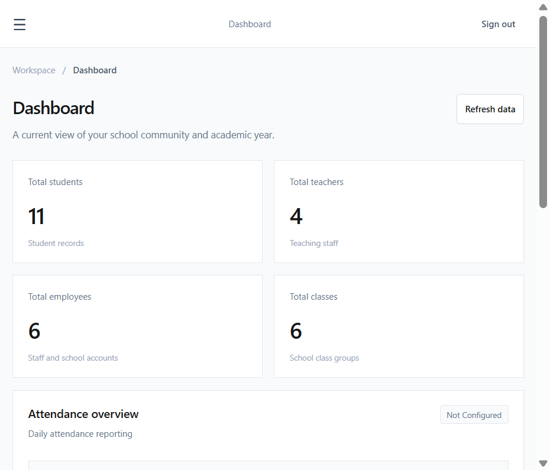
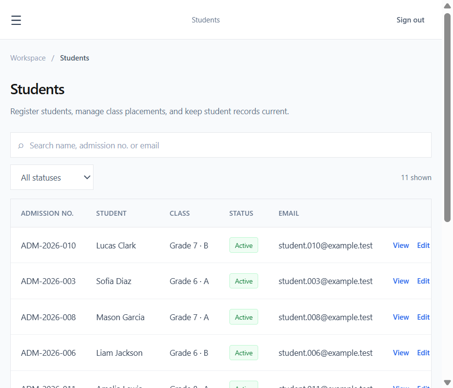
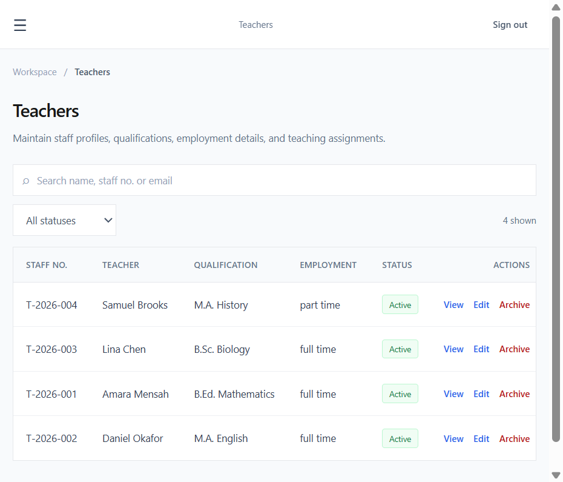
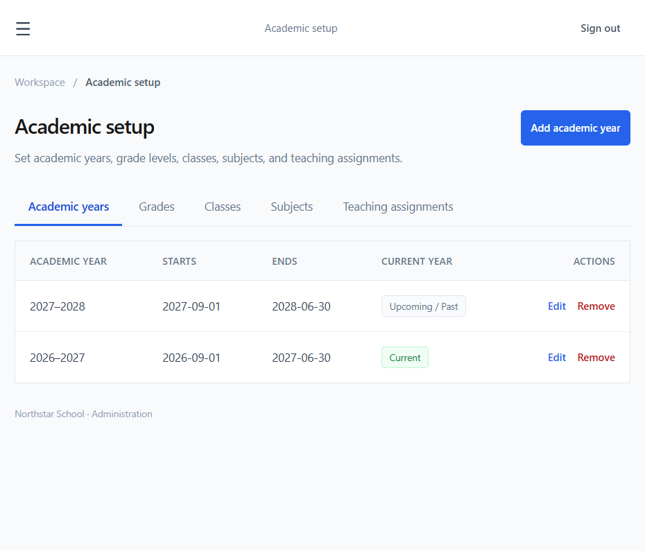

# Northstar School Management

A Laravel 12 REST API and Vue 3 administration interface for school operations.
The current working slice covers session authentication, the school dashboard,
student records and class enrollment, teacher profiles and qualifications,
academic years, grades, classes, subjects, and teacher assignments.

The architecture, initial database relationship diagram, API contract, and
planned module boundaries are documented in [docs/architecture.md](docs/architecture.md).
Attendance, examinations, timetables, fees, parent access, role administration,
and report exports are not implemented in this release slice.

## Application preview

The screenshots below show the authenticated administrator experience.

| Dashboard | Students |
|---|---|
|  |  |

| Teachers | Academic setup |
|---|---|
|  |  |

## Requirements

- PHP 8.2+ with `pdo_mysql`, `openssl`, `mbstring`, `fileinfo`, and `zip`
- Composer 2
- Node.js 20.19+ and npm
- MySQL 8.0+

On Windows, if Composer reports that ZIP support is missing, enable
`extension=zip` in the active PHP CLI `php.ini` and open a new terminal.

## Local setup

1. Create a MySQL database named `school_management` and configure the database
   credentials in `.env`.
2. Install dependencies and prepare the application:

   ```powershell
   composer install
   Copy-Item .env.example .env
   php artisan key:generate
   php artisan migrate --seed
   npm install
   npm run build
   ```

3. Configure `DB_HOST`, `DB_PORT`, `DB_DATABASE`, `DB_USERNAME`, and
   `DB_PASSWORD` in `.env`. Set `APP_TIMEZONE` to the school's IANA timezone;
   date-only school records use this timezone. For a local-only environment,
   `DB_CONNECTION=sqlite` is also supported.
4. Start the Laravel and Vite development servers:

   ```powershell
   composer run dev
   ```

   Open `http://localhost:8000`. The Vue client and API are served from the same
   origin; browser authentication uses Sanctum session cookies and CSRF tokens.

## Development accounts

`php artisan db:seed` creates local demo records and these development-only
accounts:

| Role | Email | Password |
|---|---|---|
| Administrator | `school-admin@example.test` | `SchoolAdmin#2026` |
| Registrar | `registrar@example.test` | `Registrar#2026` |

Demo seeding explicitly refuses to run in production. Change or remove these
credentials before sharing a local deployment. Do not seed demo data into a
production database.

## Tests and checks

```powershell
php artisan test
vendor/bin/pint --test
npm run build
```

Feature tests use an isolated in-memory SQLite database and cover authentication,
authorization, student enrollment lifecycle, teacher qualifications, academic
assignment integrity, and dashboard data.

## Security and operations

- There is no public account-registration endpoint. Accounts must be provisioned
  by an operator until user/role administration is implemented.
- School setup, student/teacher record updates, and profile access are available
  to administrators and registrars. Only registrars can register new students
  and teachers; the registration controls are not shown to administrators.
  Only administrators can archive student and teacher records.
- Laravel validates request data, applies policies and foreign keys, and uses
  bound ORM queries. Browser writes are protected by CSRF and same-origin
  Sanctum session authentication.
- Use HTTPS, set `APP_ENV=production`, `APP_DEBUG=false`, rotate the application
  key appropriately, and provision a non-demo administrator before deployment.
- The Laravel session and cache tables are migrated with the application.
