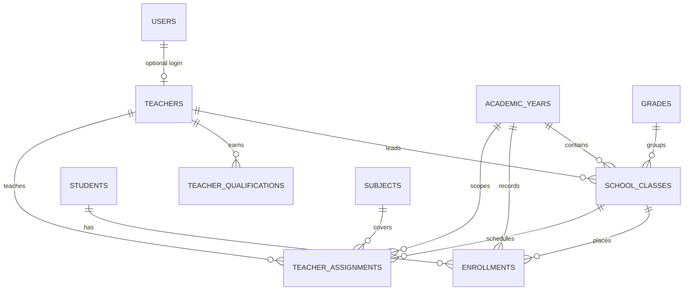

# School management system architecture

## Delivery scope

The first release slice delivers session authentication, a data-backed dashboard,
student and teacher records, and academic setup (academic years, grades, classes,
and subjects). Attendance, examinations, timetables, fees, parent access, role
administration, and exports remain planned modules; they must not be presented as
working until their schemas, authorization, APIs, and interfaces are implemented.

## Application structure

- Laravel 12 serves the Vue 3 single-page application and JSON API from one
  origin. Sanctum uses Laravel's session and CSRF protections for browser users.
- MySQL is the deployment database. SQLite is retained for isolated automated
  tests.
- Form Requests validate writes, API Resources shape responses, policies restrict
  operations, and transactional services keep related records consistent.
- Vue pages use Vue Router and Pinia; a shared Axios client sends same-origin
  requests and CSRF cookies. The database, not browser storage, is authoritative.

## Initial entities and relationships



`students` and `teachers` contain person-specific details. A student's class
history belongs to `enrollments`; subject/class/teacher assignments belong to
`teacher_assignments`. Qualification records are kept separate from employment
details. Foreign keys, unique admission numbers/codes, and compound uniqueness
constraints protect these relationships.

## Initial API contract

All routes below are prefixed with `/api`. Mutations require an authenticated
Sanctum session and a valid CSRF cookie. JSON write requests return validation
errors with status 422; unauthenticated requests return 401 and forbidden
operations return 403.

| Method | Path | Purpose |
|---|---|---|
| GET | `/sanctum/csrf-cookie` | Establish the browser's CSRF cookie before sign-in |
| POST | `/login` | Authenticate a school account |
| POST | `/logout` | End the current session |
| GET | `/user` | Return the authenticated user and role |
| GET | `/dashboard` | Return persisted counts, activity, and academic-year data |
| GET/POST | `/students` | Search/page students; register a student |
| GET/PUT/DELETE | `/students/{student}` | Read, update, or archive a student |
| GET/POST | `/teachers` | Search/page teachers; register a teacher |
| GET/PUT/DELETE | `/teachers/{teacher}` | Read, update, or archive a teacher |
| GET/POST/PUT/DELETE | `/academic-years[/{id}]` | Manage academic years |
| GET/POST/PUT/DELETE | `/grades[/{id}]` | Manage grade levels |
| GET/POST/PUT/DELETE | `/classes[/{id}]` | Manage classes |
| GET/POST/PUT/DELETE | `/subjects[/{id}]` | Manage subjects |
| GET/POST/DELETE | `/teacher-assignments[/{id}]` | Assign a teacher and subject to a class |

List endpoints accept `search` and Laravel pagination's `page` parameter. A
class assignment is made by setting a student's `class_id`; the class determines
the enrollment's academic year.

## Frontend structure

```text
resources/js/
  components/  shared tables, modal, feedback and navigation
  layouts/     authenticated application shell
  pages/       login, dashboard, students, teachers, academic setup
  router/      route definitions and session guard
  services/    same-origin Axios client and API functions
  stores/      Pinia authentication state
```

## Later module boundaries

Attendance records reference a student, class, academic year, date, and status;
exams, marks, report-card calculations, timetable slots and conflict validation,
fee invoices/payments, parent-student links, role/permission administration, and
export jobs each require dedicated tables and authorized API resources. These
are intentionally deferred until their business rules are agreed and tested.
